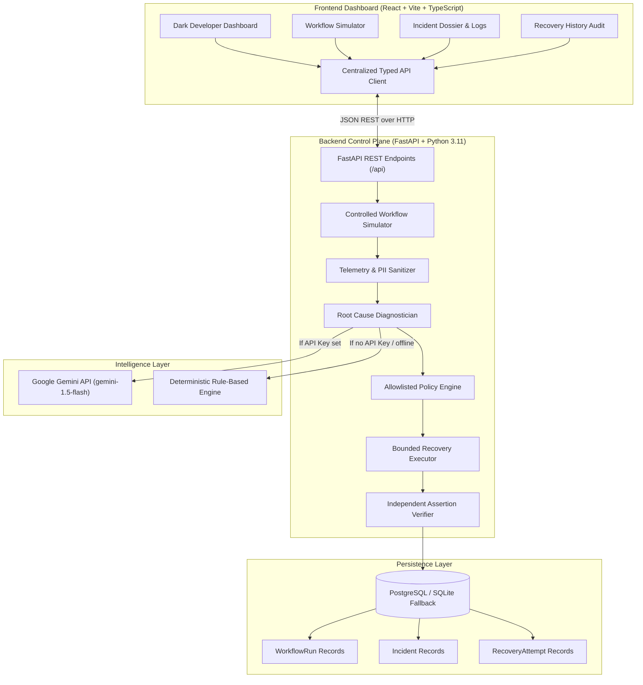

# HealFlow AI — The Self-Healing AI Automation System

> **Autonomous Closed-Loop Failure Remediation Platform**  
> *DETECT &rarr; DIAGNOSE &rarr; DECIDE &rarr; RECOVER &rarr; VERIFY &rarr; REPORT*

[](https://fastapi.tiangolo.com)
[](https://react.dev)
[](https://www.typescriptlang.org)
[](https://tailwindcss.com)
[](https://www.sqlalchemy.org)
[](https://www.postgresql.org)
[](https://pytest.org)

---

## 1. Problem Statement & Core Value

Modern distributed software systems suffer from fragile workflow breakdowns: microservice timeouts, burst HTTP 429 rate throttles, and malformed upstream payloads often trigger cascading outages or burden on-call engineers with manual, repetitive restarts.

**HealFlow AI** is a self-healing automation control plane. It captures software workflow failures, sanitizes runtime telemetry (stripping private keys, JWTs, and credentials), diagnoses probable root causes using an AI reasoning engine (with zero-dependency deterministic fallback for offline environments), evaluates allowlisted safety policies, triggers bounded idempotent recovery, and **demands rigorous post-recovery proof of verification** before marking any incident resolved.

```
       ┌─────────────────────────────────────────────────────────────┐
       │               HealFlow AI Closed Loop Cycle                 │
       └─────────────────────────────────────────────────────────────┘
                                      │
  1. DETECT    ──────► Trap unhandled exception, extract runtime logs & context
       │
  2. DIAGNOSE  ──────► Sanitize secrets, run LLM Root-Cause Analysis (or Fallback Engine)
       │
  3. DECIDE    ──────► Enforce allowlisted recovery policies & check retry budgets (<= 3)
       │
  4. RECOVER   ──────► Execute safe bounded remediation (backoff retry, rate-limit sleep)
       │
  5. VERIFY    ──────► Run formal assertion probe against target service (never assume)
       │
  6. REPORT    ──────► Persist state, update live dashboard metrics & telemetry audit trail
```

---

## 2. High-Level Architecture



---

## 3. Key Differentiators & Safety Guardrails

- **Zero Arbitrary Execution**: Untrusted LLMs are strictly advisory. HealFlow AI will **never** execute arbitrary shell commands, raw scripts, or AI-generated code.
- **Allowlisted Remediation Policies**: Every recovery handler (`RETRY_BACKOFF`, `RATE_LIMIT_BACKOFF`, `REQUEST_SCHEMA_CORRECTION`, `ESCALATE_TO_HUMAN`) is statically allowlisted and bounded.
- **Bounded Retry Ceilings**: Hard limit of maximum 3 retries. Prevents retry storms and cascading resource exhaustion.
- **Independent Verification Gate**: An incident is **never** declared `RECOVERED` without concrete evidence. An independent verification probe confirms HTTP 200 and ledger state.
- **Deep Log Sanitization**: Bearer tokens, JWTs, API keys (`sk-...`, `AIza...`), passwords, and PII are scrubbed by `LogSanitizer` before reaching any external API or database.
- **100% Reliable Live Demo**: Features an automated, explicitly labeled `FALLBACK_RULES` engine that seamlessly takes over if no LLM key is configured or if network drops.

---

## 4. Controlled Test Scenarios

| Scenario ID | Workflow Name | Simulated Failure Mode | AI / Fallback Diagnosis | Remediation Action | Final Outcome |
| :--- | :--- | :--- | :--- | :--- | :--- |
| **`timeout`** | Payment Gateway Dispatcher | Downstream HTTP 504 (socket timeout > 3000ms) | Transient network latency on downstream gateway socket | Idempotent retry with exponential backoff (`0.3s`) | **`RECOVERED`** (Verification PASSED) |
| **`rate_limit`** | CRM Inventory Sync | HTTP 429 Too Many Requests (`Retry-After: 2s`) | Target endpoint burst quota exceeded | Respect `Retry-After` cooling delay and re-dispatch | **`RECOVERED`** (Verification PASSED) |
| **`invalid_input`** | Customer KYC Verification | ValidationError: Missing mandatory field `currency` | Input schema violation at boundary | Quarantine transaction & request human operator amendment | **`NEEDS_HUMAN_REVIEW`** (Resolved via operator UI) |
| **`unrecoverable`** | Auth Token Rotation | HTTP 403 Forbidden: Client Certificate Revoked | Downstream credentials revoked on central CRL point | Halt automated retries & page on-call security engineer | **`UNRESOLVED`** (Escalated safely) |

---

## 5. Local Setup & Quickstart

### Prerequisites
- Python 3.10+ (tested on Python 3.11)
- Node.js 18+ and npm

### Step 1: Clone Repository
```bash
git clone https://github.com/your-org/healflow-ai.git
cd healflow-ai
```

### Step 2: Backend Setup
```bash
# Create and activate python virtual environment
python -m venv venv

# Windows:
.\venv\Scripts\activate
# macOS / Linux:
source venv/bin/activate

# Install dependencies
pip install -r backend/requirements.txt

# (Optional) Copy environment variables
cp backend/.env.example backend/.env
```

### Step 3: Run Automated Test Suite
Ensure all 13 core automated assertions pass:
```bash
pytest -v
```

### Step 4: Start Backend Server
```bash
# Start FastAPI backend on http://127.0.0.1:8000
python -m uvicorn app.main:app --app-dir backend --host 127.0.0.1 --port 8000 --reload
```
Interactive API documentation is immediately available at `http://127.0.0.1:8000/docs`.

### Step 5: Start Frontend Server
In a separate terminal window:
```bash
cd frontend
npm install
npm run dev
```
Open **`http://127.0.0.1:5173`** in your browser.

---

## 6. Environment Variables

### Backend (`backend/.env`)
| Variable | Default | Description |
| :--- | :--- | :--- |
| `DATABASE_URL` | `sqlite:///./healflow.db` | PostgreSQL connection string (or local SQLite fallback) |
| `AI_PROVIDER` | `gemini` | `gemini`, `openai`, or leave blank for deterministic fallback |
| `GEMINI_API_KEY` | `""` | Optional Google Gemini API key |
| `MAX_RECOVERY_RETRIES` | `3` | Maximum bounded retries allowed per incident |
| `RECOVERY_TIMEOUT_SECONDS` | `10` | Bounded execution timeout |
| `CORS_ORIGINS` | `["*"]` | Allowed CORS origins for the frontend |

### Frontend (`frontend/.env`)
| Variable | Default | Description |
| :--- | :--- | :--- |
| `VITE_API_BASE_URL` | `""` | Backend API URL (empty uses Vite `/api` reverse proxy) |

---

## 7. REST API Reference

| Method | Endpoint | Description |
| :--- | :--- | :--- |
| `GET` | `/health` | System health, database connection, and active AI engine |
| `GET` | `/api/dashboard/summary` | Real-time incident counts, recovery success %, and recent activity |
| `GET` | `/api/workflows` | List of available test scenarios and default payloads |
| `POST` | `/api/workflows/run` | Execute controlled scenario and run the closed-loop recovery engine |
| `GET` | `/api/workflows/runs` | History of workflow simulation runs |
| `GET` | `/api/incidents` | List persistent incidents (filter by `status`, `severity`) |
| `GET` | `/api/incidents/{id}` | Detailed incident record including root cause and audit log |
| `POST` | `/api/incidents/{id}/recover` | Human-approved remediation submission (e.g. inject currency) |
| `GET` | `/api/recovery-history` | Audit trail of all recovery attempts executed by policy |
| `GET` | `/api/settings/status` | Safe configuration status and allowlisted safety limits |
| `POST` | `/api/demo/reset` | Safe reset of all demo records with confirmation flag |

---

## 8. 90–120 Second Live Demo Script (For Hackathon Judges)

Follow this exact sequence for a high-impact presentation:

1. **Open the Dashboard (`0:00 - 0:20`)**:
   - Point out the **real-time metrics** (Total Incidents, Recovered, Success Rate). Emphasize that all numbers derive from actual stored database records, never fake mockups.
   - Note the **Architecture status pill** (`Database: Connected`, `AI Diagnostician: Active / Deterministic Safe Mode`).

2. **Trigger Temporary Timeout Scenario (`0:20 - 0:50`)**:
   - Click **"Run Test Workflow"** or open the **Workflow Simulator**.
   - Select **Scenario 1: Payment Gateway Dispatcher (timeout)**.
   - Click **"Execute Test Workflow"**.
   - Watch the animated closed-loop pipeline light up:
     **DETECT** &rarr; **DIAGNOSE** &rarr; **DECIDE** &rarr; **RECOVER** &rarr; **VERIFY** &rarr; **REPORT**.
   - Inspect the **Sanitized Runtime Logs**: show that tokens like `Bearer [REDACTED_JWT_TOKEN]` were scrubbed.
   - Show the verification assertion: `Verification PASSED: HTTP 200 OK received in 145ms. Transaction verified in ledger.`
   - Status badge shows **`RECOVERED`**.

3. **Demonstrate Human Escalation Guardrail (`0:50 - 1:20`)**:
   - Select **Scenario 3: Customer KYC Verification (invalid_input)**.
   - Execute the workflow.
   - Show that HealFlow **refuses to blindly guess financial currency**: status becomes **`NEEDS_HUMAN_REVIEW`**.
   - Click **"View Full Incident Dossier"**.
   - Enter `USD` into the Human Remediation input box and click **"Approve & Verify Recovery"**.
   - Watch the verification pass and the incident transition to **`RECOVERED`**.

4. **Demonstrate Unrecoverable Security Failure (`1:20 - 1:40`)**:
   - Select **Scenario 4: Auth Token Rotation (unrecoverable)**.
   - Execute the workflow.
   - Show that HealFlow detects an unrecoverable `HTTP 403 Revoked Certificate` and **halts automated retries**, escalating to human operations with status **`UNRESOLVED`**.

5. **Persistence & Refresh (`1:40 - 2:00`)**:
   - Refresh the browser page (`F5`).
   - Demonstrate that all records, metrics, and recovery attempts survive the refresh because they are stored in the database.

---

## 9. Production Cloud Deployment

### A. Deploy Frontend to Vercel
1. Push repository to GitHub.
2. Import project into [Vercel](https://vercel.com).
3. Set **Root Directory** to `frontend`.
4. Configure Build Command: `npm run build`, Output Directory: `dist`.
5. Add Environment Variable:
   - `VITE_API_BASE_URL`: `https://your-backend.onrender.com`
6. Deploy. Vercel automatically honors `frontend/vercel.json` SPA rewrite rules.

### B. Deploy Backend to Render
1. In [Render](https://render.com), create a new **Blueprint Instance** pointing to your repository.
2. Render automatically reads `render.yaml`, provisioning both the FastAPI Python service and a managed PostgreSQL database.
3. If deploying manually as a Web Service:
   - **Environment**: Python 3
   - **Build Command**: `pip install -r backend/requirements.txt`
   - **Start Command**: `cd backend && uvicorn app.main:app --host 0.0.0.0 --port $PORT`
   - **Environment Variables**:
     - `DATABASE_URL`: Your PostgreSQL connection string (e.g. from Neon, Supabase, or Render Postgres).
     - `AI_PROVIDER`: `gemini`
     - `GEMINI_API_KEY`: Your Google Gemini API key.

### C. Managed PostgreSQL Database
Compatible with any standard PostgreSQL provider:
- [Neon Serverless Postgres](https://neon.tech)
- [Supabase](https://supabase.com)
- [Render PostgreSQL](https://render.com/docs/databases)

Simply supply the database connection URL in the `DATABASE_URL` environment variable. The SQLAlchemy initialization logic will automatically provision all schemas, tables, and foreign-key indexes on startup.

---

## 10. Limitations & Future Roadmap

- **Simulated Execution Environment**: For the hackathon MVP, workflows execute against safe internal mock targets to avoid mutating real production services or incurring unpredictable external cloud costs.
- **Webhook Subscriptions**: Future iterations will support incoming webhook ingress (`/api/webhooks/pagerduty`, `/api/webhooks/datadog`) to trigger triage on live enterprise events.
- **Multi-Tenant Policy RBAC**: Future roadmap includes role-based approval gates for team lead approvals on high-blast-radius infrastructure remediation.

---

## 11. License

MIT License. Built with ❤️ for the Hackathon.
